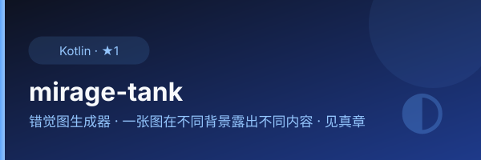

<p align="center">
  
</p>

<div align="center">
  
</div>

# Mirage Tank (幻影坦克)

Create illusion images that show different content on different backgrounds — one image visible on dark backgrounds, another on light backgrounds.

## Desktop studio（开发中，待 Actions 验收）

`desktop/` 新增无需命令行的 Lain42 幻影工坊：两图选择、强度滑块、真实黑白背景对比、透明 PNG / ZIP 导出、取消和工作区删除。Windows WebView2 安装 EXE / 便携 ZIP，Linux 本机浏览器 ZIP。原 Android 应用和 Rust 核心算法保持不变。

当前尚未发布桌面安装包。所有编译、构建、测试及安装验收只在 [GitHub Actions](https://github.com/lilyco-42/mirage-tank/actions/workflows/desktop.yml) 运行；不要求用户在本机编译。交付限制和运行说明见 [桌面说明](desktop/README.md)。

## How It Works

The algorithm uses alpha blending to encode a "hidden" image and a "surface" image into a single PNG with transparency. On a **black background**, the hidden image is revealed; on a **white background**, the surface image appears.

```
result = foreground * alpha + background * (1 - alpha)
       ↳ hidden  image visible on dark  bg (alpha → 1)
       ↳ surface image visible on light bg (alpha → 0)
```

## Project Structure

```
rust/
├── demo/              # Rust library + CLI binary
│   ├── src/
│   │   ├── lib.rs     # Core algorithm + JNI exports for Android
│   │   ├── main.rs    # CLI entry point (old version)
│   │   └── demo-cli.rs# CLI binary "mirage-cli"
│   └── Cargo.toml
├── app/               # Android app (Jetpack Compose)
│   └── src/main/java/com/lilyco/timi/MainActivity.kt
├── build.gradle.kts   # Android Gradle build (root)
├── settings.gradle.kts
└── gradle.properties
```

## Usage

### CLI

```bash
# The surface image is resized to the hidden image dimensions.
# Run the prebuilt binary; source builds are handled by GitHub Actions.
demo-cli hidden.jpg surface.jpg output.png
# Optional intensity values; the legacy 3-path invocation keeps its defaults.
demo-cli hidden.jpg surface.jpg output.png 100 128
```

### Android App

Open the `app/` directory in Android Studio, build and run. The app provides:
- Image picker for hidden & surface images
- Real-time preview with black/white background toggle
- Adjustable intensity sliders
- Save result to gallery (PNG encoded via Rust native library)

### Library

```rust
use demo::combine_images;

let result = combine_images(&hidden_gray_img, &surface_gray_img);
result.save("output.png").unwrap();
```

### Local desktop API

The desktop app starts FastAPI only on a random `127.0.0.1` port. Its temporary HttpOnly session protects file and task routes. No arbitrary shell endpoint or public file server is exposed. It uses the original `demo-cli` binary to generate the PNG.

## Building for Android

Requires [cargo-ndk](https://github.com/bbqsrc/cargo-ndk) and Android NDK.

```bash
cargo install cargo-ndk
# Set ANDROID_NDK_HOME or configure ndk.dir in local.properties
```

The Gradle build automatically triggers `cargo ndk` to compile the Rust library into `app/src/main/jniLibs/`.

## License

MIT
